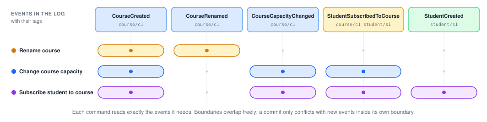

# Dynamic Consistency Boundaries (DCB)

## What is DCB?

**Dynamic Consistency Boundary** (DCB) is a pattern for event-sourced systems where the unit of consistency is defined at command-handling time rather than fixed to a single aggregate stream.

In traditional event-sourcing each command targets one aggregate (e.g. `order-42`) and optimistic concurrency is enforced by checking the aggregate stream's version.

DCB generalises this: the consistency boundary is expressed as a **query** over a set of event types (and an optional filter). Before reading, a **condition** captures the current global position in the event log. After building state from those events, the handler commits its new events together with the condition. The commit engine then checks whether any new matching events appeared — if so, a conflict is raised.

This removes the need to route every command through a fixed aggregate, enabling commands that naturally span multiple entities while retaining strong consistency guarantees.

Consider the classic example from Sara Pellegrini's talk: students subscribing to courses. The event `StudentSubscribedToCourse` concerns both a Student and a Course — in a traditional aggregate model it is unclear which aggregate owns it, and the Course aggregate keeps growing with every new event type:


DCB resolves this by letting each command handler declare exactly which events it needs to be consistent with. Different commands define different boundaries that can freely overlap:



---

## The DCB Query Model

The formal DCB specification (see [dcb.events](https://dcb.events)) expresses every read intent as a list of **query items**. Each item pairs an array of event types with an array of **domain-identifier tags**:

```javascript
const queryItems = [
    { types: ['CourseCreated', 'CourseCapacityChanged', 'StudentSubscribedToCourse'],
      tags:  ['course/jdsj4'] },
    { types: ['StudentCreated', 'StudentSubscribedToCourse'],
      tags:  ['student/gfh3j'] }
];
```

An event matches when **any** item matches it: the event's type must be in that item's `types` **and** the event must carry **all** of that item's tags.

- **Items** combine with **OR** — any matching item is sufficient.
- **`tags` within an item** combine with **AND** — all tags must be present.
- **`types` within an item** combine with **OR** — any listed type is sufficient.

Both `types` and `tags` are optional per item. An item without `types` matches all event types; an item without `tags` requires no tag match. An item with neither selects all events.

---

## Using DCB in event-storage

DCB workflows follow four steps that map directly to the query model above.

### Step 1 — Configure stream indexes

`query()` operates on named streams. Configure `typeAccessor` and `tagsAccessor` so the store creates and maintains those streams automatically on every `commit()`:

```javascript
const store = new EventStore('my-store', {
    storageDirectory: './data',
    typeAccessor: 'type',   // dot-notation path to the event type field in the payload
    tagsAccessor: 'tags'    // dot-notation path to an array of tag strings in the payload
});
```

`typeAccessor` creates one stream per event-type value under `types/{type}` — `CourseCreated` becomes stream `types/CourseCreated`. `tagsAccessor` creates one stream per tag value under `tags/{tag}` — `'course/jdsj4'` becomes stream `tags/course/jdsj4`. Tag values are recommended to use `/` as a hierarchy separator.

Both property paths are automatically registered in the IndexMatcher discriminant table so stream routing on every write is O(1).

> **New stores only:** stream indexes are created with `reindex=false` and only cover events committed after the index first appears. Configure both options from the beginning if you intend to use `query()`.

### Step 2 — Query with DcbQuery

Pass a `DcbQuery` object directly to `query()`. Its `items` array maps one-to-one to the query model:

```javascript
const { stream, condition } = store.query({
    items: [
        { types: ['CourseCreated', 'CourseCapacityChanged'], tags: ['course/jdsj4'] },
        { types: ['StudentCreated'],                          tags: ['student/gfh3j'] }
    ]
});
```

`query()` detects the `{ items }` shape, compiles each item to the equivalent selector algebra internally, and returns:

- **`stream`** — an `EventStream` of all matching events.
- **`condition`** — the query definition and current global event-log position; pass it to `commit()` to enforce the concurrency check.

An optional second argument further narrows the boundary to exactly the events that would affect the decision:

```javascript
const { stream, condition } = store.query(
    { items: [{ types: ['OrderPlaced', 'OrderShipped'] }] },
    (event, metadata) => event.orderId === 'order-42'   // optional matcher
);
```

The matcher can be a predicate function or the object-matcher syntax (see [Matchers](matchers.md)). Unrelated events of the same type (e.g. a different order) never cause spurious conflicts.

> **Note:** streams listed in the query that do not exist yet are still checked correctly at commit time — a stream created by another writer between `query()` and `commit()` is included in the conflict check.

`query()` treats missing referenced streams as empty sets — a missing stream in an `OR` group has no effect; a missing stream in an `AND` group makes that branch yield nothing.

### Step 3 — Build the decision model

Iterate the stream to reconstruct the application state relevant to the command:

```javascript
const model = new CourseModel();
stream.forEach((event, metadata) => {
    model.apply(event);
});
```

### Step 4 — Commit with the condition

Commit the resulting events together with the condition captured in Step 2:

```javascript
import { OptimisticConcurrencyError } from 'event-storage';

try {
    store.commit('enrollment-...', [
        { type: 'StudentSubscribedToCourse', courseId: 'jdsj4', studentId: 'gfh3j', tags: ['course/jdsj4', 'student/gfh3j'] }
    ], condition);
} catch (e) {
    if (e instanceof OptimisticConcurrencyError) {
        // A conflicting event appeared between query and commit — replay and retry
    }
}
```

---

## Conflict Semantics

| Scenario | Result |
|----------|--------|
| No new events of any listed type appeared | ✅ No conflict |
| New events appeared, but none match the `matcher` | ✅ No conflict |
| New events appeared and at least one matches the `matcher` | ❌ `OptimisticConcurrencyError` |
| New events appeared and no `matcher` was provided | ❌ `OptimisticConcurrencyError` |

---

## Full Example

```javascript
import { EventStore } from 'event-storage';

const store = new EventStore('accounts', {
    storageDirectory: './data',
    typeAccessor: 'type'
});

store.on('ready', () => {

    function handleRegisterCustomer(command) {
        const { stream, condition } = store.query(
            ['types/CustomerRegistered'],
            (event) => event.email === command.email
        );

        let emailTaken = false;
        stream.forEach((event) => {
            if (event.email === command.email) emailTaken = true;
        });

        if (emailTaken) {
            throw new Error(`Email ${command.email} is already registered`);
        }

        store.commit(`customer-${command.customerId}`, [
            { type: 'CustomerRegistered', customerId: command.customerId, email: command.email }
        ], condition);
    }

    handleRegisterCustomer({ customerId: 'cust-1', email: 'alice@example.com' });
});
```

---

## Without Tag Streams — Matcher-Only Queries

Tag streams are optional. When tag cardinality is low or write throughput is the primary concern, encode the per-item tag logic in the `matcher` instead. Pass the union of all relevant types and evaluate tag membership at read time.

**Prefer the object-matcher `$has` or `$hasAny` operator** over a function matcher for tag containment — both compile to a fast byte-level check in raw mode and are significantly cheaper than deserialising and invoking a JS function per event.

```javascript
const courseId  = 'course/jdsj4';
const studentId = 'student/gfh3j';

// $has performs an array-containment check on payload.tags without a function matcher.
const { stream, condition } = store.query(
    ['types/CourseCreated', 'types/CourseCapacityChanged', 'types/StudentCreated', 'types/StudentSubscribedToCourse'],
    {
        payload: { tags: { $has: courseId } }
    }
);

// $hasAny matches events whose tags contain any of the listed values.
const { stream, condition } = store.query(
    ['types/CourseCreated', 'types/CourseCapacityChanged', 'types/StudentCreated', 'types/StudentSubscribedToCourse'],
    {
        payload: { tags: { $hasAny: [courseId, studentId] } }
    }
);
```

If the per-item logic really needs cross-field OR/AND semantics that the object matcher cannot express, fall back to a function matcher:

```javascript
const { stream, condition } = store.query(
    ['types/CourseCreated', 'types/CourseCapacityChanged', 'types/StudentCreated', 'types/StudentSubscribedToCourse'],
    (event, meta) =>
        (['CourseCreated', 'CourseCapacityChanged', 'StudentSubscribedToCourse'].includes(event.type)
            && event.tags?.includes(courseId))
        ||
        (['StudentCreated', 'StudentSubscribedToCourse'].includes(event.type)
            && event.tags?.includes(studentId))
);
```

Both variants require no `tagsAccessor` configuration and no tag-stream writes. The trade-off is that more events must be deserialized at read time to evaluate the matcher; `$has` keeps that overhead close to a raw byte scan, while function matchers force full JSON parsing per event.

---

## Choosing Between Matcher-Only and Tag Streams

Both approaches are valid and can coexist.

- **Matcher-only**: no additional tag indexes to maintain; lower write amplification.
- **Tag streams**: more index writes per commit (one extra index write per configured tag stream), but can reduce read-time misses and deserialization/evaluation overhead when tag cardinality is high.

Rule of thumb:

- higher write load / lower read selectivity pressure → matcher-only is often better,
- lower write load / high tag diversity with many matcher misses → tag streams are often better.

Measurements for the three approaches are on the [Performance](performance.md#dcb-scenarios) page.

## Selector Algebra (Advanced)

`DcbQuery` compiles each item to the nested selector algebra that `query()` and `fromStreams()` understand natively. The algebra uses alternating OR/AND depth semantics (see [Joining Streams](organizing-streams.md#joining-streams)):

- depth 0 (top-level array): OR across query items
- depth 1 (per-item array): AND — tag stream intersected with the type-group stream
- depth 2 (inner array): OR across event types

The compiled form of the earlier DcbQuery example is equivalent to:

```javascript
const { stream, condition } = store.query([
    ['tags/course/jdsj4', ['types/CourseCreated', 'types/CourseCapacityChanged']],
    ['tags/student/gfh3j', ['types/StudentCreated']]
]);
```

Selection happens at the index level: only events at the intersection of the tag stream and the relevant type streams are yielded, without deserializing unrelated documents.

You can pass the nested array form directly to `query()` when the query shape cannot be expressed as a flat list of `{ types, tags }` items, or when you want full control over which streams are joined. A flat `['types/TypeA', 'types/TypeB']` is a top-level OR join over those streams. `query()` also supports raw mode — see [Writing and Reading Events](reading-writing.md#raw-mode-ndjson-for-network-streaming).
