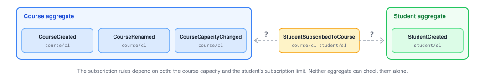

# Dynamic Consistency Boundaries (DCB)

## What is DCB?

**Dynamic Consistency Boundary** (DCB) is a pattern for event-sourced systems where the unit of consistency is defined at command-handling time rather than fixed to a single aggregate stream.

In traditional event-sourcing each command targets one aggregate (e.g. `order-42`) and optimistic concurrency is enforced by checking the aggregate stream's version.

DCB generalises this: the consistency boundary is expressed as a **query** over a set of event types (and an optional filter). Before reading, a **condition** captures the current global position in the event log. After building state from those events, the handler commits its new events together with the condition. The commit engine then checks whether any new matching events appeared — if so, a conflict is raised.

This removes the need to route every command through a fixed aggregate, enabling commands that naturally span multiple entities while retaining strong consistency guarantees.

Consider the classic example from Sara Pellegrini's talk: students subscribing to courses. The event `StudentSubscribedToCourse` concerns both a Student and a Course — in a traditional aggregate model it is unclear which aggregate owns it, and the Course aggregate keeps growing with every new event type:



DCB resolves this by letting each command handler declare exactly which events it needs to be consistent with. The boundary follows the decision instead of the entity, so it runs across the aggregates rather than along them. Different commands define different boundaries, which may overlap freely:


---

## The DCB Query Model

The formal DCB specification (see [dcb.events](https://dcb.events)) expresses every read intent as a list of **query items**. Each item pairs an array of event types with an array of **domain-identifier tags**:

```javascript
const queryItems = [
    { types: ['CourseCreated', 'CourseCapacityChanged', 'StudentSubscribedToCourse'],
      tags:  ['course/jdsj4'] },
    { types: ['StudentCreated', 'StudentSubscribedToCourse'],
      tags:  ['student/gfh3j'] }
];
```

An event matches when **any** item matches it: the event's type must be in that item's `types` **and** the event must carry **all** of that item's tags.

- **Items** combine with **OR** — any matching item is sufficient.
- **`tags` within an item** combine with **AND** — all tags must be present.
- **`types` within an item** combine with **OR** — any listed type is sufficient.

Both `types` and `tags` are optional per item. An item without `types` matches all event types; an item without `tags` requires no tag match. An item with neither selects all events.

---

## Using DCB in event-storage

DCB workflows follow four steps that map directly to the query model above.

### Step 1 — Configure stream indexes

`query()` operates on named streams. Configure `typeAccessor` and `tagsAccessor` so the store creates and maintains those streams automatically on every `commit()`:

```javascript
const store = new EventStore('my-store', {
    storageDirectory: './data',
    typeAccessor: 'type',   // dot-notation path to the event type field in the payload
    tagsAccessor: 'tags'    // dot-notation path to an array of tag strings in the payload
});
```

`typeAccessor` creates one dedicated stream per distinct event-type value — `CourseCreated`, `StudentSubscribedToCourse`, etc. `tagsAccessor` creates one stream per tag value under `tags/{tag}` — `'course/jdsj4'` becomes stream `tags/course/jdsj4`. Tag values are recommended to use `/` as a hierarchy separator.

Both property paths are automatically registered in the IndexMatcher discriminant table so stream routing on every write is O(1).

> **New stores only:** stream indexes are created with `reindex=false` and only cover events committed after the index first appears. Configure both options from the beginning if you intend to use `query()`.

### Step 2 — Query with DcbQuery

Pass a `DcbQuery` object directly to `query()`. Its `items` array maps one-to-one to the query model:

```javascript
const { stream, condition } = store.query({
    items: [
        { types: ['CourseCreated', 'CourseCapacityChanged'], tags: ['course/jdsj4'] },
        { types: ['StudentCreated'],                          tags: ['student/gfh3j'] }
    ]
});
```

`query()` detects the `{ items }` shape, compiles each item to the equivalent selector algebra internally, and returns:

- **`stream`** — an `EventStream` of all matching events.
- **`condition`** — the query definition and current global event-log position; pass it to `commit()` to enforce the concurrency check.

An optional second argument further narrows the boundary to exactly the events that would affect the decision:

```javascript
const { stream, condition } = store.query(
    { items: [{ types: ['OrderPlaced', 'OrderShipped'] }] },
    (event, metadata) => event.orderId === 'order-42'   // optional matcher
);
```

The matcher can be a predicate function or the object-matcher syntax (see [Matchers](matchers.md)). Unrelated events of the same type (e.g. a different order) never cause spurious conflicts.

> **Note:** streams listed in the query that do not exist yet are still checked correctly at commit time — a stream created by another writer between `query()` and `commit()` is included in the conflict check.

`query()` treats missing referenced streams as empty sets — a missing stream in an `OR` group has no effect; a missing stream in an `AND` group makes that branch yield nothing.

### Step 3 — Build the decision model

Iterate the stream to reconstruct the application state relevant to the command:

```javascript
const model = new CourseModel();
stream.forEach((event, metadata) => {
    model.apply(event);
});
```

### Step 4 — Commit with the condition

Commit the resulting events together with the condition captured in Step 2:

```javascript
import { OptimisticConcurrencyError } from 'event-storage';

try {
    store.commit('enrollment-...', [
        { type: 'StudentSubscribedToCourse', courseId: 'jdsj4', studentId: 'gfh3j', tags: ['course/jdsj4', 'student/gfh3j'] }
    ], condition);
} catch (e) {
    if (e instanceof OptimisticConcurrencyError) {
        // A conflicting event appeared between query and commit — replay and retry
    }
}
```

---

## Conflict Semantics

| Scenario | Result |
|----------|--------|
| No new events of any listed type appeared | ✅ No conflict |
| New events appeared, but none match the `matcher` | ✅ No conflict |
| New events appeared and at least one matches the `matcher` | ❌ `OptimisticConcurrencyError` |
| New events appeared and no `matcher` was provided | ❌ `OptimisticConcurrencyError` |

---

## Full Example

```javascript
import { EventStore } from 'event-storage';

const store = new EventStore('accounts', {
    storageDirectory: './data',
    typeAccessor: 'type'
});

store.on('ready', () => {

    function handleRegisterCustomer(command) {
        const { stream, condition } = store.query(
            ['CustomerRegistered'],
            (event) => event.email === command.email
        );

        let emailTaken = false;
        stream.forEach((event) => {
            if (event.email === command.email) emailTaken = true;
        });

        if (emailTaken) {
            throw new Error(`Email ${command.email} is already registered`);
        }

        store.commit(`customer-${command.customerId}`, [
            { type: 'CustomerRegistered', customerId: command.customerId, email: command.email }
        ], condition);
    }

    handleRegisterCustomer({ customerId: 'cust-1', email: 'alice@example.com' });
});
```

---

## Projections and Decision Models

Instead of folding the query stream by hand (Step 3), you can describe the decision model as a set of small **projections** in the format used by [dcb.events](https://dcb.events/topics/projections/). The projection API lives in the `event-storage/projections` subpath.

A projection declares its initial state, one pure reducer per event type, and the tags every handled event must carry. Its DCB query is derived from that: the handler keys become `types`, the `tagFilter` becomes `tags`.

```javascript
import { createProjection } from 'event-storage/projections';

const CourseExists = (courseId) => createProjection({
    initialState: false,
    when: { CourseDefined: () => true },
    tagFilter: [`course/${courseId}`]
});

const CourseCapacity = (courseId) => createProjection({
    initialState: 0,
    when: {
        CourseDefined: (state, event) => event.capacity,
        CourseCapacityChanged: (state, event) => event.newCapacity
    },
    tagFilter: [`course/${courseId}`]
});

const CourseSubscriptions = (courseId) => createProjection({
    initialState: 0,
    when: { StudentSubscribedToCourse: (state) => state + 1 },
    tagFilter: [`course/${courseId}`]
});

CourseCapacity('c1').query;
// { items: [{ types: ['CourseDefined', 'CourseCapacityChanged'], tags: ['course/c1'] }] }
```

Handlers receive `(state, event, metadata)`. `event` is the stored payload itself (not a `{ type, data, tags }` wrapper), and `metadata` is the storage metadata (e.g. `committedAt`). Handlers must be pure and return the new state.

`buildDecisionModel(store, projections)` composes the projections, runs one `query()` for all of them, and applies each event only to the projections whose query it matches. It returns the composed state and the condition to pass to `commit()`:

```javascript
import { buildDecisionModel } from 'event-storage/projections';

function subscribeStudent({ studentId, courseId, semesterId }) {
    const { state, commitCondition } = buildDecisionModel(store, {
        exists: CourseExists(courseId),
        capacity: CourseCapacity(courseId),
        subscriptions: CourseSubscriptions(courseId)
    });

    if (!state.exists) throw new Error('Unknown course');
    if (state.subscriptions >= state.capacity) throw new Error('Course is full');

    store.commit(`semester-${semesterId}`, [
        { type: 'StudentSubscribedToCourse', courseId, studentId, tags: [`course/${courseId}`, `student/${studentId}`] }
    ], commitCondition);
}
```

- A single projection can be passed instead of a map; `state` is then that projection's state.
- `composeProjections({ ... })` builds the composed projection without reading, e.g. for unit tests without a store.
- Projections require `typeAccessor`, and `tagsAccessor` when any projection uses a `tagFilter`.
- The returned `DecisionModel` is immutable. `model.update()` reads only the events committed since the model was built, applies them to its state and returns a new model with a new `commitCondition` (or the same model when nothing was committed).

### Updating a decision model

After an `OptimisticConcurrencyError`, update the model instead of rebuilding it and decide again:

```javascript
function subscribeStudent({ studentId, courseId, semesterId }, attempts = 3) {
    let model = buildDecisionModel(store, { capacity: CourseCapacity(courseId), subscriptions: CourseSubscriptions(courseId) });
    for (let attempt = 1; ; attempt++) {
        if (model.state.subscriptions >= model.state.capacity) throw new Error('Course is full');
        try {
            store.commit(`semester-${semesterId}`, [
                { type: 'StudentSubscribedToCourse', courseId, studentId, tags: [`course/${courseId}`, `student/${studentId}`] }
            ], model.commitCondition);
            return;
        } catch (e) {
            if (!(e instanceof OptimisticConcurrencyError) || attempt === attempts) throw e;
            model = model.update(); // reads only the new events
        }
    }
}
```

A process that handles many commands for the same boundary can also keep the model in memory and call `update()` before each decision. When nothing changed, `update()` costs one length comparison; otherwise it reads only the new matching events through the indexes.

```javascript
const courses = new Map(); // courseId -> DecisionModel

function courseModel(courseId) {
    const model = courses.get(courseId)?.update()
        ?? buildDecisionModel(store, { capacity: CourseCapacity(courseId), subscriptions: CourseSubscriptions(courseId) });
    courses.set(courseId, model);
    return model;
}
```

This stays correct because the conflict check runs at `commit()` against the store, not against the cached model: a stale model only leads to an `OptimisticConcurrencyError`, never to a wrong commit. Bounding the cache (e.g. an LRU over the ids) is up to the application, as one model is kept per id.

### Finding the conflicting events

After an `OptimisticConcurrencyError`, `model.since()` returns the events that block the commit: the events matching the model's condition that were committed after the model was built. It is an `EventStream`, so it can be iterated or read with `forEach((event, metadata) => ...)`.

```javascript
try {
    store.commit(`semester-${semesterId}`, events, model.commitCondition);
} catch (e) {
    if (!(e instanceof OptimisticConcurrencyError)) throw e;
    for (const event of model.since()) {
        console.log('conflicting', event.type);
    }
}
```

`model.since(condition)` does the same for any other condition with the model's position, e.g. a narrowed one.

### Narrowing the commit condition

A decision may depend on fewer events than the decision model reads. A course's free seats count subscriptions and unsubscriptions, but a concurrent unsubscription cannot make a new subscription invalid. `commitCondition.without(...types)` returns a new condition at the same position that ignores new events of those types:

```javascript
const model = buildDecisionModel(store, {
    capacity: CourseCapacity(courseId),
    taken: createProjection({
        initialState: 0,
        when: {
            StudentSubscribedToCourse: (state) => state + 1,
            StudentUnsubscribedFromCourse: (state) => state - 1
        },
        tagFilter: [`course/${courseId}`]
    })
});

if (model.state.taken >= model.state.capacity) throw new Error('Course is full');

store.commit(`semester-${semesterId}`, [subscription], model.commitCondition.without('StudentUnsubscribedFromCourse'));
```

- The original condition is unchanged; `without()` accepts several types or an array.
- The types are removed from each query item; an item with no types left is dropped. The tags stay.
- It throws when no type would be left (commit without a condition instead), for query items without `types` (they match every type), and for conditions created from a selector instead of a `DcbQuery`.

### Read models

A read model is the same projection, kept up to date for queries instead of for one decision. `createReadModel(store, projections, options)` catches up through the stream indexes asynchronously, in batches of `batchSize` global positions (default 1000) so a large store does not block the event loop, and then applies every new matching event synchronously as it is written:

```javascript
import { createProjection, createReadModel } from 'event-storage/projections';

const CourseOverview = createProjection({
    initialState: {},
    when: {
        CourseDefined: (state, e) => ({ ...state, [e.id]: { capacity: e.capacity, subscribed: 0 } }),
        StudentSubscribedToCourse: (state, e) => ({
            ...state,
            [e.courseId]: { ...state[e.courseId], subscribed: state[e.courseId].subscribed + 1 }
        })
    }
});

const overview = createReadModel(store, CourseOverview, { name: 'course-overview', persist: true, version: 1 });

overview.on('caught-up', (state, position) => { /* serve queries from here */ });
overview.on('progress', (position) => { /* after each catch-up batch */ });
overview.caughtUp;  // true once it follows new commits live
overview.update();  // catch up synchronously right now, e.g. at startup when the state is needed immediately

overview.state;     // current state
overview.position;  // global position of the last event it has seen
overview.on('change', (state, position) => { /* e.g. invalidate an HTTP cache */ });
overview.close();   // stop following, write a pending persist
```

- **Decision model vs. read model:** both are a projection's state at a global position. A decision model is narrow (its query is the consistency boundary) and updated on demand right before a decision. A read model is usually broad (e.g. all courses), follows the store by itself and may be read at any time. Deciding on a broad read model works, but any change within its query causes a conflict.
- **Persistence (optional):** with `persist: true` and a `name`, state and position are written atomically to `<indexDirectory>/readmodels/`. After a restart only the events committed since are read. The state must be JSON-serializable. Change `version` when the handlers change; a persisted state of another version, or of another query, is rebuilt.
- **Read-only processes:** a read model in a store opened with `readOnly: true` follows the events written by the writer process.
- **Warm decision model:** `readModel.decisionModel()` returns a `DecisionModel` from the read model's current state, so a narrow read model kept up to date anyway can serve decisions without replaying its events.

### Mapping to the dcb.events specification

event-storage implements the semantics of the [DCB specification](https://dcb.events/specification/) but keeps its own API names. The translation:

| dcb.events | event-storage | Notes |
|---|---|---|
| `Query` with `QueryItem { types, tags }` | `DcbQuery { items: [{ types, tags }] }` passed to `query()` | Same semantics: items OR, tags AND, types OR |
| Sequence position | Global event number (1-based) | `store.length` is the position of the last event |
| `read(query, { from })` | `query(dcbQuery, null, minRevision)` | Returns `{ stream, condition }` |
| `AppendCondition` | `CommitCondition` returned by `query()` / `buildDecisionModel()` | Passed as the third argument of `commit()` |
| `AppendCondition.failIfEventsMatch` | `CommitCondition.dcbQuery`, compiled to `CommitCondition.selector` (+ optional `matcher`) | Narrow it with `condition.without(...types)` |
| `AppendCondition.after` | `CommitCondition.noneMatchAfter` | `store.length` at query time |
| `append(events, condition)` | `commit(streamName, events, condition)` | See below |
| `createProjection`, `composeProjections`, `buildDecisionModel` | Same names in `event-storage/projections` | |
| Projection `handlers` | `when` | `{ when: { CourseDefined: (state, event, metadata) => ... } }` |
| Decision model `appendCondition` | `commitCondition` | Same object as `condition` from `query()` |

`commit()` requires a stream name where the specification has none. The stream does not take part in the DCB conflict check, which runs only over the condition's query. It decides the **physical partition** the events are written to. Choosing a domain partition (e.g. `semester-${id}`) keeps related events together and lets reads stay selective, which is what makes the semester-bounded mode in the benchmark below the fastest.

---

## Without Tag Streams — Matcher-Only Queries

Tag streams are optional. When tag cardinality is low or write throughput is the primary concern, encode the per-item tag logic in the `matcher` instead. Pass the union of all relevant types and evaluate tag membership at read time.

**Prefer the object-matcher `$has` or `$hasAny` operator** over a function matcher for tag containment — both compile to a fast byte-level check in raw mode and are significantly cheaper than deserialising and invoking a JS function per event.

```javascript
const courseId  = 'course/jdsj4';
const studentId = 'student/gfh3j';

// $has performs an array-containment check on payload.tags without a function matcher.
const { stream, condition } = store.query(
    ['CourseCreated', 'CourseCapacityChanged', 'StudentCreated', 'StudentSubscribedToCourse'],
    {
        payload: { tags: { $has: courseId } }
    }
);

// $hasAny matches events whose tags contain any of the listed values.
const { stream, condition } = store.query(
    ['CourseCreated', 'CourseCapacityChanged', 'StudentCreated', 'StudentSubscribedToCourse'],
    {
        payload: { tags: { $hasAny: [courseId, studentId] } }
    }
);
```

If the per-item logic really needs cross-field OR/AND semantics that the object matcher cannot express, fall back to a function matcher:

```javascript
const { stream, condition } = store.query(
    ['CourseCreated', 'CourseCapacityChanged', 'StudentCreated', 'StudentSubscribedToCourse'],
    (event, meta) =>
        (['CourseCreated', 'CourseCapacityChanged', 'StudentSubscribedToCourse'].includes(event.type)
            && event.tags?.includes(courseId))
        ||
        (['StudentCreated', 'StudentSubscribedToCourse'].includes(event.type)
            && event.tags?.includes(studentId))
);
```

Both variants require no `tagsAccessor` configuration and no tag-stream writes. The trade-off is that more events must be deserialized at read time to evaluate the matcher; `$has` keeps that overhead close to a raw byte scan, while function matchers force full JSON parsing per event.

---

## Choosing Between Matcher-Only and Tag Streams

Both approaches are valid and can coexist.

- **Matcher-only**: no additional tag indexes to maintain; lower write amplification.
- **Tag streams**: more index writes per commit (one extra index write per configured tag stream), but can reduce read-time misses and deserialization/evaluation overhead when tag cardinality is high.

Rule of thumb:

- higher write load / lower read selectivity pressure → matcher-only is often better,
- lower write load / high tag diversity with many matcher misses → tag streams are often better.

Measurements for the three approaches are on the [Performance](performance.md#dcb-scenarios) page.

## Selector Algebra (Advanced)

`DcbQuery` compiles each item to the nested selector algebra that `query()` and `fromStreams()` understand natively. The algebra uses alternating OR/AND depth semantics (see [Joining Streams](organizing-streams.md#joining-streams)):

- depth 0 (top-level array): OR across query items
- depth 1 (per-item array): AND — tag stream intersected with the type-group stream
- depth 2 (inner array): OR across event types

The compiled form of the earlier DcbQuery example is equivalent to:

```javascript
const { stream, condition } = store.query([
    ['tags/course/jdsj4', ['CourseCreated', 'CourseCapacityChanged']],
    ['tags/student/gfh3j', ['StudentCreated']]
]);
```

Selection happens at the index level: only events at the intersection of the tag stream and the relevant type streams are yielded, without deserializing unrelated documents.

You can pass the nested array form directly to `query()` when the query shape cannot be expressed as a flat list of `{ types, tags }` items, or when you want full control over which streams are joined. A flat `['TypeA', 'TypeB']` is a top-level OR join over those streams. `query()` also supports raw mode — see [Writing and Reading Events](reading-writing.md#raw-mode-ndjson-for-network-streaming).
