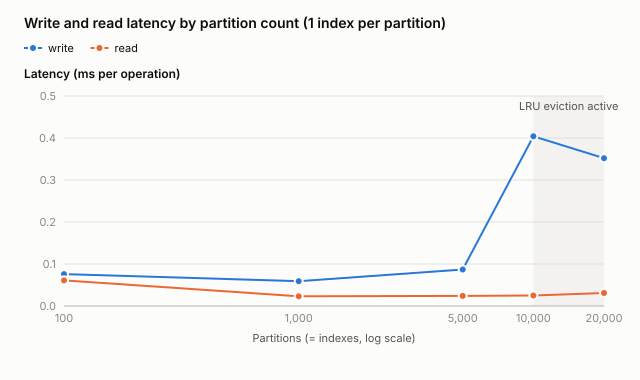
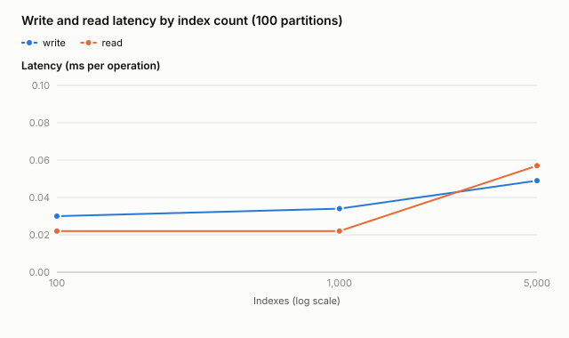
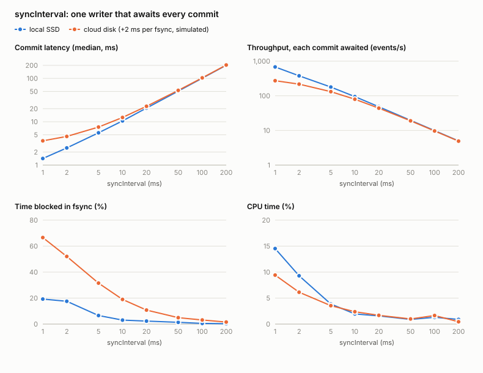

# Performance

This page documents the write, read, and startup performance of node-event-storage at scale and explains how to tune the two main parameters that control it.

Benchmarks were captured on Node.js v20 with the default configuration (`matcherProperties: ['stream', 'payload.type']`, `maxOpenPartitions: 1024`).  Each document is ~108 bytes.  Write samples are averaged over 100 consecutive `write()` calls with all secondary indexes registered.  Read samples are averaged over 100 reads spread evenly through the primary index.

---

## Scenario A — 1 index per partition (growing partitions)

Each partition holds 20 documents.  The number of secondary indexes equals the number of partitions.

| Partitions | Startup (ms) | Write (ms/op) | Read (ms/op) |
|------------|-------------:|---------------:|--------------:|
| 100        |          7.1 |          0.076 |         0.061 |
| 1 000      |         43.4 |          0.059 |         0.023 |
| 5 000      |        177.9 |          0.087 |         0.024 |
| 10 000     |        355.5 |          0.404 |         0.025 |
| 20 000     |        871.4 |          0.352 |         0.031 |



---

## Scenario B — 100 fixed partitions, growing index count

The partition count is fixed at 100.  The document set grows proportionally so each index receives at least 20 documents.

| Indexes | Startup (ms) | Write (ms/op) | Read (ms/op) |
|---------|-------------:|---------------:|--------------:|
| 100     |          2.9 |          0.030 |         0.022 |
| 1 000   |         22.1 |          0.034 |         0.022 |
| 5 000   |        246.2 |          0.049 |         0.057 |



---

## Analysis

### Write latency

Write latency is kept near-constant across both dimensions by the **discriminant lookup table** (see [Tuning: `matcherProperties`](#matcherproperties) below).  Instead of testing every registered matcher on every `write()` call (O(N) scan), the store does a two-level `Map` lookup on the document's discriminant property and only evaluates the one or two indexes that actually match.

The visible spike at 10 000 and 20 000 partitions in Scenario A (0.40–0.35 ms) is caused by **LRU partition-pool eviction**.  When the number of live partitions exceeds `maxOpenPartitions` (default 1 024) the store must close and reopen a file descriptor on every write that touches a cold partition.  Below that threshold write latency stays flat at ≤ 0.09 ms regardless of how many total indexes are registered.  See [Tuning: `maxOpenPartitions`](#maxopenpartitions) for guidance on eliminating this spike.

### Read latency

Read latency is dominated by the per-document partition seek and is largely flat in Scenario A because reads are served from the OS page cache after the first pass.  The jump at 5 000 indexes in Scenario B (0.057 ms) reflects the larger document set per partition (1 000 docs/partition vs. 20) rather than the index count itself.

### Startup time

Startup time scales linearly with the number of files on disk:

- The store performs one `readdir` call over the data directory followed by one `open` per partition.
- Registering secondary indexes (`openIndex` / `ensureIndex`) costs one `open` + header-read per index file.

For large deployments consider lazy-loading secondary indexes on first access rather than opening all of them during startup.

---

## Tuning

### `syncInterval` and commit latency

With `syncInterval`, a commit callback fires only after the next sync run has `fsync`ed the commit. A commit therefore takes about the interval plus the `fsync`s of that run, no matter how fast the write itself is. A smaller interval lowers that latency, but every run costs at least one `fsync`, so the store runs up to `1000 / syncInterval` of them per second. A run syncs its files in the background on the libuv thread pool, so the event loop goes on writing while the disk confirms the writes. Each run still costs CPU time for the timer, the flushes and the callbacks, and every `fsync` loads the disk. A file whose descriptor is still open is synced through it; only a file closed meanwhile is opened again just for the sync.



The chart shows one writer that awaits each commit before the next, like an import that awaits every `commit()`. On a disk with about 2 ms per `fsync`, typical for a cloud persistent disk:

| `syncInterval` | Median commit latency | Events/s | `fsync`s/s | CPU time |
|---|---|---|---|---|
| 1 ms | 4.7 ms | 212 | 212 | 18 % |
| 5 ms | 9.1 ms | 107 | 107 | 11 % |
| 20 ms | 24.3 ms | 40 | 40 | 4.9 % |
| 100 ms | 105 ms | 9 | 9 | 1.3 % |
| `syncOnFlush` | 3.5 ms | 279 | 279 | 18 % |
| default (no sync) | < 0.01 ms | about 200,000 | 0 | 100 % (CPU-bound) |

`syncOnFlush` behaves like an interval of 0: a run starts right after the current tick, and commits during a run share the next one.

What follows from this:

- **An awaited commit can never be faster than the interval.** A writer that awaits every commit reaches at most `1000 / syncInterval` commits per second. More generally, throughput is the number of commits in flight divided by the commit latency, until the CPU is saturated.
- **Pipeline commits instead of lowering the interval.** Don't wait for each callback when you import: issue the commits and wait for the last one, or keep a window of commits in flight. All commits within one interval share one run. With 8192 commits in flight and 2 ms per `fsync`, the store writes about 160,000 events/s at a 1 to 20 ms interval, close to the 200,000 events/s without any sync. A smaller interval doesn't raise that, because the store is then bound by the CPU.
- **Each changed file costs one `fsync` per run.** A run syncs every partition written since the previous run, plus every new partition or index file and its directory. It syncs them in parallel, at most as many at once as the libuv thread pool has threads (`UV_THREADPOOL_SIZE`, 4 by default). Commits to 64 different streams within one interval therefore cost 64 `fsync`s per run, and with 2 ms per `fsync` a run takes about 50 ms. Then the number of streams written per interval matters more than the interval. A larger `UV_THREADPOOL_SIZE` shortens such runs if the disk handles parallel writes well, as cloud disks usually do. Runs never overlap: when the interval elapses while a run is still syncing, the next run starts right after it.
- **Choose the longest interval the callers can wait for.** 20 to 100 ms keep the `fsync` load small even on slow disks. Below about 5 ms, the runs cost a noticeable share of CPU time and load the disk with hundreds of `fsync`s per second.

The numbers come from `node bench/bench-sync-interval.js <added fsync latency ms> <writers> <commits in flight per writer>` on a 4-core machine with a local SSD (about 0.17 ms per `fsync`). The added `fsync` latency is simulated, so measure on your own disk before you choose an interval.

### `matcherProperties`

`matcherProperties` controls which document properties are used to build the fast O(1) discriminant table.  The default value `['stream', 'payload.type']` covers the standard `EventStore` workload where each stream maps to exactly one secondary index matched by a `{ stream: '<name>' }` object.

```js
// Default — optimises for stream-keyed indexes
new Storage('events', { matcherProperties: ['stream', 'payload.type'] });

// Override when your documents use a different discriminant field
new Storage('events', { matcherProperties: ['tenantId', 'eventType'] });

// Disable — every write evaluates all registered matchers (O(N) scan)
new Storage('events', { matcherProperties: [] });
```

At index registration the store inspects the matcher object and stores the index name in a two-level Map keyed by the first `matcherProperties` entry whose value is a scalar in the matcher.  On `write()` the store extracts the same property from the incoming document and looks up only the matching index names — one Map lookup and one `matches()` call instead of N.

Function matchers and object matchers that do not contain any `matcherProperties` key are placed in an unclassified set and are always evaluated (they contribute an O(M) term where M is their count, independent of the total index count).

### `maxOpenPartitions`

`maxOpenPartitions` caps the number of simultaneously open partition file descriptors.  The default is **1 024**.  When a `write()` or `read()` needs a partition whose file descriptor has been evicted, the store closes the LRU entry and reopens the requested one.

| Scenario | Recommendation |
|----------|---------------|
| Partition count ≤ `maxOpenPartitions` | Default is fine; all partitions stay open and write latency is flat. |
| Partition count slightly above `maxOpenPartitions`, all partitions accessed frequently | Raise `maxOpenPartitions` to cover the full partition count, or set it to `0` to disable eviction entirely. |
| Very large partition count (tens of thousands), access is skewed to a working set | Leave the default; the LRU naturally keeps the hot partitions open. |
| Memory or fd budget is tight | Lower `maxOpenPartitions`. Each open partition costs one fd and the OS typically needs ~8 KB of kernel memory per open file. |

```js
// Raise the cap to avoid LRU eviction when all partitions are active
new Storage('events', {
    maxOpenPartitions: 4096
});

// Disable the cap entirely — one fd per partition stays open until close()
new Storage('events', {
    maxOpenPartitions: 0
});
```

!!! note
    At 10 000 partitions with the default cap of 1 024, every write touches a different partition in the sample, so every write triggers a close+reopen.  Setting `maxOpenPartitions` to `0` (or ≥ 10 000) reduces write latency at that scale from ~0.40 ms back to ~0.09 ms.


### Raw mode benchmarks

These benchmarks measure pure **read operations** (no writes). The range scan reads the middle third of the log.

| Scenario | Variant | Events/sec | Deviation | Runs |
|----------|---------|-----------:|----------:|-----:|
| forward full scan | stable | 452,500 | ±0.83% | 60 |
| forward full scan | latest | 411,800 | ±1.25% | 55 |
| forward full scan | latest(raw) | 877,300 | ±0.83% | 75 |
| --- | --- | ---: | ---: | ---: |
| backwards full scan | stable | 421,000 | ±0.56% | 56 |
| backwards full scan | latest | 421,400 | ±0.32% | 56 |
| backwards full scan | latest(raw) | 871,600 | ±0.66% | 75 |
| --- | --- | ---: | ---: | ---: |
| join stream | stable | 424,500 | ±0.35% | 56 |
| join stream | latest | 396,500 | ±0.43% | 53 |
| join stream | latest(raw) | 798,000 | ±0.77% | 69 |
| --- | --- | ---: | ---: | ---: |
| range scan | stable | 453,288 | ±0.28% | 86 |
| range scan | latest | 423,291 | ±0.45% | 81 |
| range scan | latest(raw) | 886,578 | ±0.59% | 90 |

### Raw Buffer Operator Matcher Benchmark

This benchmark compares the same matcher definitions in two execution modes:

- **`obj` (baseline):** run `matches(document, matcher)` on already deserialized events
- **`raw`:** run `buildRawBufferMatcher(matcher)` directly on NDJSON buffers

Matcher objects used in `bench/bench-matcher.js`:

```js
{ type: 'Foo' }
{ payload: { type: 'Foo' } }
{ payload: { type: ['BazingaHappened', 'Foo'] } }
{ payload: { type: ['BazingaHappened', 'BarxingaHappened', 'QuuxingaHappened', 'Foo'] } }
{ payload: { value: { $gt: 100 } } }
{ payload: { type: { $eq: 'Foo' } } }
{ payload: { value: { $gte: 100, $lt: 2000 } } }
{ payload: { value: { $gte: 100, $lt: 2000 }, type: 'Foo' } }
```

Observed median delta (`raw` vs `obj`) from the benchmark run:

Across all tested match ratios:

- Compared with matching **already deserialized** objects, raw matching is roughly **40–55% slower**.
- Compared with **deserializing first and then** matching the object, raw matching is roughly **50–60% faster**.

Interpretation:

- When events are **already deserialized**, object matchers are the correct baseline and typically faster.
- In workloads where data is still in **raw buffer form** (streaming), raw matchers avoid `JSON.parse` and can outperform a deserialize+object-match pipeline by roughly **~50%** in practice.

## DCB scenarios

This benchmark is inspired by the excellent pyeventsourcing speedrun style: a compact scenario that makes architectural trade-offs visible under sustained write-then-read pressure.

Benchmark setup (the script is not yet part of the repository):

- scenario: course subscriptions with DCB read model rebuilding,
- runtime: 3 seconds per mode,
- per iteration: 10 student registrations, 10 course registrations, 100 enrollments (120 operations total),
- each mode runs against a fresh data directory.

Recent measurements with that setup produced the following excerpt:

| Mode                    | Ops/s | us/op | Relative vs matcher-only |
|-------------------------|------:|------:|-------------------------:|
| Matcher-only            |   372 |  2690 |                    1.00x |
| Tag-streams             |  1241 |   806 |                    3.34x |
| Semester-bounded stream |  3606 |   277 |                    9.69x |

Mode definitions and how to apply them in practice:

- **Matcher-only**: query by event types and evaluate tags only via matcher logic at read time. Practical setup: keep type streams, avoid tag streams, call `query(types, matcher)`.
- **Tag-streams**: materialize tags as dedicated streams and build DCB context from stream selectors. Practical setup: configure `tagsAccessor` and use `DcbQuery` or nested selector algebra via `query()`.
- **Semester-bounded stream**: write all decision-relevant events for a semester into `semesters/{id}` so the read context stays naturally bounded. Practical setup: choose business-bounded write streams first, then query only within that boundary.

This demonstrates three important points:

- pure matcher-only DCB can degrade when the scanned context grows without a hard domain boundary,
- DCB according to the full types+tags specification is usually fast enough with tag streams, but this can create many streams and extra index writes,
- the best long-term approach is often domain partitioning (bounded write streams), so reads are naturally selective even without additional tag/type streams.

Compared to generic SQL-backed event-store speedruns (including the pyeventsourcing benchmark context), this indicates that event-storage can outperform when stream boundaries reflect real domain limits, not only technical entity ownership.

For the semester case specifically, realistic systems typically need one more filter/intersection for enrollment-relevant types because a semester stream may contain many unrelated events. Two common options are:

- keep one semester stream and intersect with enrollment-related event types during context read,
- split into `semester/{id}/students`, `semester/{id}/courses`, and `semester/{id}/enrolments`, then build the DCB context from the join of those three streams.

---
